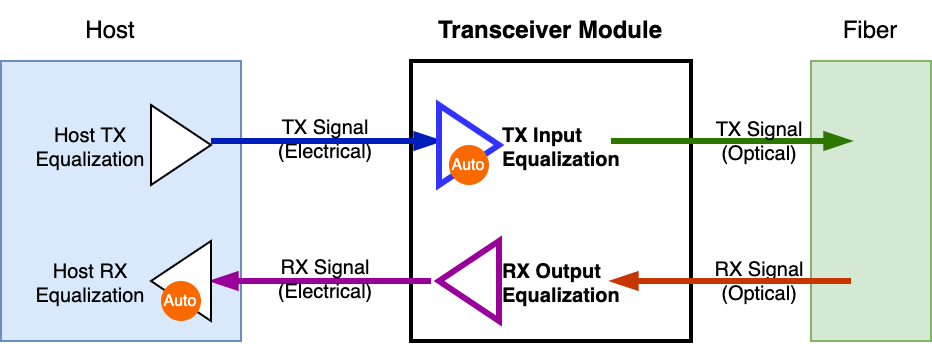

Understanding Transceiver Equalization
========================================

High-speed transceivers use electrical signal equalization to compensate for channel impairments and maintain reliable communication with the host system.

At the transceiver's host electrical interface, two important equalization functions are **Tx Input Equalization** and **Rx Output Equalization**. The Tx and Rx designations refer to the transceiver's data paths, rather than the direction of the electrical signals relative to the host.

.. _eq_in_transceiver_module:

    Tx Input Equalization and Rx Output Equalization in Pluggable Optical Transceivers

Tx Input Equalization
######################

Tx Input Equalization operates on the electrical signal received by the transceiver from the host transmitter.

As the signal travels through PCB traces, connectors, and other electrical interconnects, frequency-dependent attenuation can introduce inter-symbol interference (ISI) and degrade signal quality.

The TX Input Equalizer compensates for these electrical channel impairments to improve signal recovery within the transceiver.

Depending on the module's capabilities, Tx Input Equalization may operate adaptively or use fixed settings configured through CMIS.

Rx Output Equalization
######################

Rx Output Equalization shapes the electrical signal driven from the transceiver's RX output toward the host receiver.

The output equalizer may provide programmable amplitude, precursor emphasis, and postcursor emphasis to compensate for the frequency-dependent characteristics of the module-to-host electrical channel.

Proper Rx Output Equalization improves the quality of the signal presented to the host receiver, helping reduce bit errors and improve link reliability.

Equalization Configuration and Adaptation
##########################################

Equalization may be configured manually or optimized automatically, depending on the interface and implementation.

Rx Output Equalization commonly uses techniques such as CTLE and DFE to compensate for channel loss and ISI.

Tx Input Equalization typically uses programmable amplitude and emphasis coefficients. These coefficients may be manually configured or adjusted through supported link-training mechanisms.

CMIS provides standardized controls for supported transceiver signal integrity parameters. The actual capabilities and behavior must be determined from the module's advertised features.